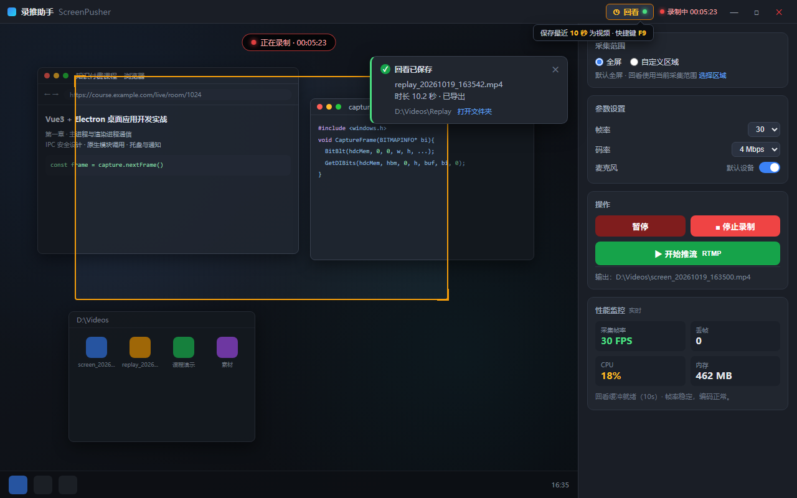

# 光束录推 BeamScreenPusher

> 轻量、开箱即用的 Windows / macOS 桌面录屏与直播推流工具。像 OBS 一样强大，但更简单、更轻量。

  

光束录推（BeamScreenPusher）是一款桌面工具：**一键录制屏幕为本地视频**，或**把屏幕画面实时推流到直播平台**，无需繁琐配置，打开就能用。

## ✨ 功能特性

- **屏幕录制**：录制屏幕为 MP4 视频，支持**全屏**或**自定义区域**，可暂停 / 恢复
- **直播推流**：一键推流到 B 站 / 抖音 / 视频号等平台的 RTMP 地址，网络中断自动重连
- **回看保存**：点一下标题栏的「回看」按钮，把**刚刚过去的 10 秒**（可自定义时长）保存成视频——没来得及按录制，也能事后补救
- **实时预览**：录制 / 推流前即可看到画面与采集范围，所见即所得
- **性能监控**：实时显示采集帧率、CPU、内存占用，低配置机器自动降帧提示
- **系统托盘**：最小化到托盘继续工作，录制状态一目了然
- **中文界面**：深色专业风格，所有功能开箱即用

## 🖼 界面预览

 

## 📥 下载安装

前往 [GitHub Releases](https://github.com/dalinv/beam-screen-pusher/releases)下载对应平台的安装包：

| 平台 | 文件 | 说明 |
| --- | --- | --- |
| Windows 10 / 11 | `BeamScreenPusher-1.0.0-win-x64-setup.exe` | 安装版（推荐） |
| Windows 10 / 11 | `BeamScreenPusher-1.0.0-win-x64-portable.exe` | 免安装版，解压即用 |

> 首次运行提示：
> - **Windows**：项目暂无代码签名证书，可能提示「未知发布者」，点击「更多信息 → 仍要运行」即可

## 🚀 快速上手

1. **选择采集范围**：启动后默认全屏录制；点击「自定义区域」拖拽框选指定范围
2. **调整参数**（可选）：帧率（15 / 30 / 60）、码率（自动 / 2 / 4 / 8 Mbps）、麦克风开关
3. **开始录制 / 推流**：点击「开始录制」保存本地视频，或填入 RTMP 地址「开始推流」直播
4. **回看保存**：任何时刻点击标题栏「◷ 回看」按钮（或按快捷键 F9），立即把最近 10 秒保存为视频，自动命名并通知保存位置
5. **停止**：录制完成后点击「停止」，视频自动保存到输出目录

## ❓ 常见问题

**Q：录制的视频保存在哪里？**
A：默认保存在 `D:\Videos`，可在「设置 → 录制」中修改输出目录。

**Q：回看按钮是灰色的点不了？**
A：回看功能默认关闭（后台常驻会占用少量资源）。在「设置 → 回看」中开启后即可使用，并可调整保存时长（5~60 秒）与快捷键。

**Q：回看保存的视频内容是什么？**
A：点击按钮**之前**那段时间的画面（默认最近 10 秒），比如刚刚打完的一波精彩操作、刚讲完的一个知识点。

**Q：推流到哪个平台？**
A：支持所有提供 RTMP 地址的平台（B 站、抖音、视频号、Twitch 等），在直播平台的「开播设置」中复制推流地址填入即可。

**Q：会消耗多少性能？**
A：1080p@30fps 录制 / 推流时 CPU 占用约 20%~60%（视电脑配置），性能面板可实时查看；回看功能关闭时不占用任何资源。

## 📄 开源协议

本项目基于 [MIT](LICENSE) 协议开源，欢迎使用、修改与再分发。
